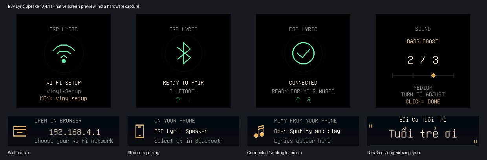

# ESP Lyric Speaker · 0.4.11

A two-board Bluetooth speaker with a rotating vinyl display, synced lyrics and a rotary encoder. No phone companion app or SD card is needed.

**[Open the USB web installer](https://huyvector.github.io/esp-lyric-speaker/)** · [Wiring](#wiring) · [Source licenses](NOTICE.md)

## Install / Nạp ROM

Open the installer in desktop Chrome or Edge with a USB data cable. Flash **both boards**, one at a time: Audio for the original ESP32 WROOM, Display for the ESP32-C3 Super Mini. Each button accepts only its chip family. Close other serial monitors first. If connecting fails, hold BOOT, tap RESET, release BOOT and retry.

The browser installer writes a full factory image and resets saved settings/pairing on that board. It is intended for first installation or recovery. Back up anything important before using it. To update this project's existing dual-board layout without resetting Wi-Fi/cache, use the terminal `--app` method below instead.

Tiếng Việt: Mở trang nạp bằng Chrome/Edge trên máy tính, dùng cáp USB truyền dữ liệu. Nạp lần lượt cả ESP32 (Audio) và ESP32-C3 (Display). Bản nạp web là bản factory, sẽ đặt lại cấu hình của bo được nạp; không dành cho giữ nguyên cài đặt khi cập nhật.

## Hardware

- Original ESP32 WROOM 30-pin, 4 MB flash, with Bluetooth Classic A2DP.
- ESP32-C3 Super Mini, 4 MB flash, for Wi-Fi, lookup, cache, two displays and controls.
- GC9A01 round 240 × 240 SPI TFT.
- ST7789 76 × 284 SPI TFT, used horizontally at 284 × 76.
- HW-040 rotary encoder, powered from 3.3 V.
- WeAct I2S Speaker Module V1, PCM5100A + dual PA (3.3–5 V module). This is the amplified board, not a bare PCM5102A line-out DAC.
- Speaker and a suitable regulated 5 V supply. No SD module.

ESP32-C3/S3 cannot replace the original audio ESP32: this firmware uses Bluetooth Classic. Display modules with different offsets, backlight circuits or controllers need adaptation.

## Wiring

Numbers are **GPIO**, not header position. This table is the fixed pin map of the supplied ROM.

| Module / signal | Board | GPIO |
| --- | --- | --- |
| Both TFTs: SDA / DIN / MOSI | ESP32-C3 | 1 |
| Both TFTs: SCL / CLK | ESP32-C3 | 0 |
| Both TFTs: DC | ESP32-C3 | 8 |
| Both TFTs: RES / RST | ESP32-C3 | 3 |
| GC9A01 round: CS | ESP32-C3 | 21 |
| ST7789 lyric: CS | ESP32-C3 | 4 |
| HW-040: CLK | ESP32-C3 | 7 |
| HW-040: DT | ESP32-C3 | 10 |
| HW-040: SW | ESP32-C3 | 20 |
| UART TX → ESP32 RX | ESP32-C3 → ESP32 | 5 → 22 |
| UART RX ← ESP32 TX | ESP32-C3 ← ESP32 | 6 ← 23 |
| WeAct PCM5100A: BCK | ESP32 | 13 |
| WeAct PCM5100A: WS | ESP32 | 14 |
| WeAct PCM5100A: DIN | ESP32 | 27 |

Both TFTs share MOSI, clock, DC and reset, with separate CS. All boards/modules must share GND; signal levels are 3.3 V. Leave C3 USB GPIO18/19 free. GPIO8 is a boot strap: avoid circuitry forcing it to the wrong level during reset.

For the tested ST7789 module, **BL → GND** (active low); other modules may differ. The round module has no exposed brightness pin. Power the TFT logic as specified by the module manufacturer.

WeAct board: VCC → 5 V, MC → GND, SD → 3V3. For mono, use L+ and L−; leave R+/R− unused. L− is an amplifier output, not ground. The firmware sends `(L+R)/2` to both channels. Do not tie together independent USB 5 V outputs. Route amplifier power separately from the sensitive signal wiring.

## First playback

1. After flashing, connect the two boards using the crossed UART above and common ground.
2. Join **Vinyl-Setup**, password **vinylsetup**. Open **http://192.168.4.1** if the portal does not open automatically. Scan/select a 2.4 GHz Wi-Fi network and enter its password. Configuration is saved only after a successful connection.
3. Pair your phone to **ESP Lyric Speaker**, then play music. Spotify on iPhone is the development setup.
4. C3 fetches lyrics from LRCLIB and artwork from iTunes using track metadata; it reuses its bounded LittleFS cache. Some tracks have no lyrics/artwork, and first lookup needs Internet. Timing accuracy depends on the Bluetooth source's AVRCP position reports; estimated timing is used when unavailable.

The firmware and setup portal use English. Song titles and Vietnamese lyrics retain their original text. No lyrics, album art, music, personal network settings or API credentials are included in this repository.

## Controls

| Encoder gesture | Action |
| --- | --- |
| Turn | Volume, with a ring around the round screen |
| Single click | Play / pause |
| Double click | Next track |
| Triple click | Previous track |
| Hold | Open menu |
| Turn in menu / click | Select item / confirm |

Menu includes lyrics/visualizer modes, Wi-Fi setup, update/IP, and **Bass Boost** (Off / Low / Medium / High). Visualizers: auto rotate, ribbons, orbit, starfield and waves. These use peak telemetry; they are not FFT measurements. The UI preview below is a native renderer output, not a photograph of hardware.



## Terminal flashing and logs (macOS)

Download and extract this repository. With Python 3 installed, open Terminal in its folder:

```sh
bash flash.command --role display
# Close the monitor with Ctrl+C, connect the audio board, then:
bash flash.command --role audio
```

The helper creates a local Python environment with pinned esptool/pyserial when needed. It prompts for a USB port when several are detected. Factory is the default and resets configuration. Logs are written locally under `logs/<role>/`; never publish those logs without reviewing them.

For an update **only after this project's dual-board factory partition layout is already installed**:

```sh
bash flash.command --role display --app
bash flash.command --role audio --app
```

Use `--monitor-only` for logs without flashing; `--help` lists options. Serial is 115200 baud. Both boards must use the same release. Firmware checksums are in `firmware/SHA256SUMS.txt`. The `.vup` file is a dual-board update bundle for the firmware's local update page, not a browser USB image.

## Build from source

PlatformIO: Espressif32 6.10.0 / Arduino-ESP32 2.0.17. External libraries are version pinned; patched ESP32-A2DP and TFT_eSPI sources are vendored with patch notes and licenses.

```sh
pio run -d audio
pio run -d display
python3 test/run.py
python3 test/flash_test.py
```

See `tools/package.py --help` for packaging with esptool 4.x. No production performance or safety certification is implied. Version 0.4.11 was built and checked with native tests; the final release has not yet been flashed and observed on the complete physical assembly. See [validation](VALIDATION.md).

Application source: MIT. Bundled dependencies, fonts and certificates keep their respective licenses; see [NOTICE.md](NOTICE.md) and `licenses/`.
